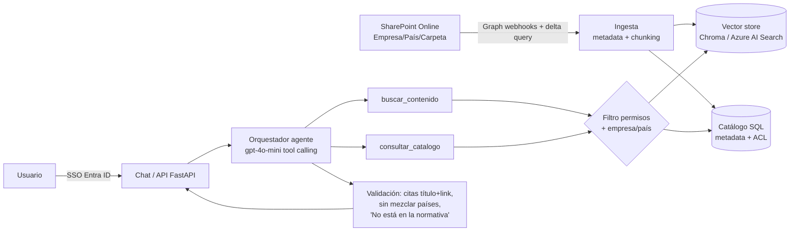

# Arquitectura - Asistente de Normativa Interna Grupo Altamar

## Requisitos -> componentes

| # | Requisito | Componente |
|---|---|---|
| 1 | Responder sobre normativa por empresa/país | `app/tools.py` (filtros obligatorios), `app/agent.py` |
| 2 | Actualización automática al cambiar documentos | `app/watcher.py` (prod: Graph webhooks/delta) + `POST /reindex` |
| 3 | Respetar permisos de SharePoint | `permisos.json` + `puede_ver()` aplicado antes del ranking |
| 4 | Citar fuente (título + link) | `app/agent.py` (campo `fuentes` y texto "Fuente:") |
| 5 | No mezclar países / pedir aclaración | `app/agent.py` (una sección por país, pregunta empresa/país) |
| 6 | No inventar: "No está en la normativa" | `app/search.py` (umbral de cobertura) + reglas del agente |

## Simulación local -> producción

| Local | Producción |
|---|---|
| `sharepoint_sim/` en disco | SharePoint Online (sitio Normativa) |
| `watchdog` | Microsoft Graph change notifications + delta query |
| Búsqueda TF-IDF en memoria | Chroma / Azure AI Search con embeddings (`text-embedding-3-small`) |
| SQLite | Azure SQL / PostgreSQL |
| `permisos.json` | Grupos de Entra ID + permisos de SharePoint sincronizados |
| `usuario` en el body | Token SSO (Entra ID / OIDC) |
| Router por reglas | gpt-4o-mini con tool calling (se activa con `OPENAI_API_KEY`) |
